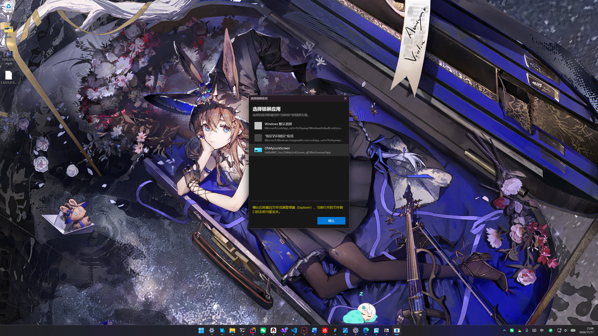

# LockScreenSwitcher

简易锁屏应用切换器。

## 开始使用

首先确保您的系统满足以下要求：

- Windows 11 或以上系统，x64 架构

然后按以下步骤开始使用：

1. 前往[Releases](https://github.com/HelloWRC/LockScreenSwitcher/releases/latest)，选第一个产物下载
2. 运行下载的程序
3. 选择你要切换到的锁屏
4. 点击【确定】
5. 完成！现在按下 <kbd>Win</kbd> + <kbd>L</kbd>，你应该就能看到你设置的锁屏应用出现在屏幕上了。

## 常见问题

### 1. 为什么 Windows 内置的那两个锁屏应用是两个色块？

答：因为它们的图标就长这样。

### 2. 我被困在了第三方的锁屏应用解锁不了了怎么办？

答：按 <kbd>Ctrl</kbd> + <kbd>Alt</kbd> + <kbd>Del</kbd> 可强制退出锁屏界面，进入登录界面。

### 3. 我怎么恢复系统原生锁屏？

答：按[开始使用](#开始使用)中的方法打开应用，然后选择「Windows 默认锁屏」作为锁屏应用，然后点击「确认」应用即可。

## 许可证

本应用基于 [GPLv3](./LICENSE) 授权。
